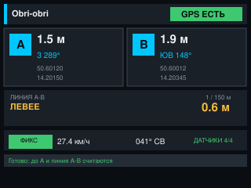
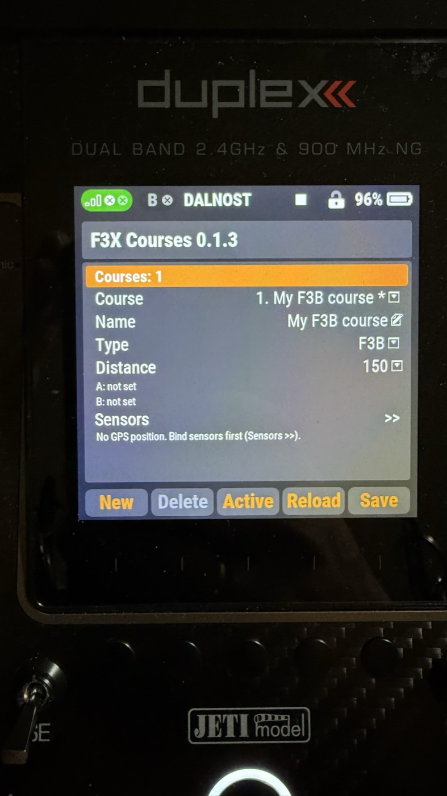

# F3X Courses

Приложение на Lua для передатчиков **JETI DC/DS** — менеджер курсов и помощник по базовой линии для F3B (150 м).

Цель проекта: заменить путаную настройку [F3F Tool](https://github.com/frank-sc/F3F-Tool-V2) на понятный интерфейс:
одно меню, библиотека именованных курсов, мастер настройки по двум базам, понятный лётный экран.

**Текущий статус: 0.1.6 — интерфейс на русском, окно телеметрии на весь экран без полосы прошивки, файл `f3xc.lua`.**
Регистрация в меню, курсы в JSON, привязка сенсоров, прибор с базами A/B и линией A–B.
Математики ворот и писка пока **нет** — это шаги B и C (см. [docs/ROADMAP.md](docs/ROADMAP.md)).
Что менялось по версиям — [docs/CHANGELOG.md](docs/CHANGELOG.md).





## Что уже работает

- Один пункт в `Menu → Applications`: **F3X Courses**, внутри переход `Датчики >>`.
- Список курсов хранится в `Apps/f3xc/courses.jsn` и переживает выключение передатчика.
- Курс можно создать из текущей позиции GPS, переименовать, задать тип (F3B/F3F) и дистанцию,
  удалить, выбрать активным.
- Привязка сенсоров: список **всех** телеметрических значений (не только GPS), Lat / Lon / Speed / Dir.
  Датчики, которые уже встречались в поле, привязываются точно по профилю (`GPSLog3` — Lat=3, Lon=4,
  Speed=5, Dir=9); остальные подбираются по названиям, вручную можно поменять любое.
- Телеметрийное окно: активный курс, тип, дистанция, координаты GPS, расстояние до базы A, скорость.
- Весь интерфейс — на русском: окно телеметрии, формы, сообщения, подписи кнопок.

**Важно про русские буквы.** В API 1.7 таблица символов шрифта (коды 171–382)
кириллицы не перечисляет, русской локали в `Lang/` нет — поэтому после установки
сначала проверьте, что надписи читаются, а не выводятся квадратами
([docs/TEST-CHECKLIST.md](docs/TEST-CHECKLIST.md), п. 7).

## Проверено на железе

- DS-24 II, прошивка 6.06, модель `0005PIKE.jsn` (PIKE-ELECTRO).
- **Приложение запущено и работает:** форма открывается, виджеты строятся,
  журнал `Apps/f3xc/lastrun.txt` пишет `ready` (24.11.2026).
- Датчик — `GPSLog3` (JETI GPS Logger 3), ID `823632641`. Скорость отдаёт в **км/ч**.
- Подробности и таблица параметров — [docs/SENSOR-NOTES.md](docs/SENSOR-NOTES.md), п. 6.

## Установка

Подробно — [docs/INSTALL.md](docs/INSTALL.md). Чек-лист проверки — [docs/TEST-CHECKLIST.md](docs/TEST-CHECKLIST.md).
Коротко:

1. Скопировать `Apps/f3xc.lua` в папку `Apps` на диске передатчика.
2. **Добавить приложение в активные:** `Menu → Applications` → **F3 (Plus)** откроет
   список доступных файлов → выделить `f3xc.lua` → **нажать крутилку** (Enter).
   Плюс сам список только открывает, добавляет нажатие крутилки. Без этого шага
   приложения в меню не будет — активных на модель максимум 10.
3. `Menu → Applications → F3X Courses` → крутилка. Приложение откроется.

Если пункта в меню нет — [docs/TROUBLESHOOT-NO-MENU.md](docs/TROUBLESHOOT-NO-MENU.md).

Приложение пишет только в `Apps/f3xc/`, каталог создаётся само при первом запуске.

## Работа над проектом

Правило: **любое изменение выгружается в GitHub сразу** — код, документация и
скриншот, чтобы любую версию можно было вернуть и посмотреть.

```bash
bash tools/sync-github.sh              # добавить всё, закоммитить, запушить
bash tools/sync-github.sh "текст"      # со своим сообщением
```

История версий — [docs/CHANGELOG.md](docs/CHANGELOG.md), скриншоты —
[docs/screens/](docs/screens/), подробный журнал — [docs/PROGRESS.md](docs/PROGRESS.md).
Вернуться к любой версии: `git log --oneline`, затем `git checkout <коммит>`.

## Требования

- JETI **DS-24 II** (проверяется на нём) или любой цветной Gen-2 с поддержкой Lua: DC/DC-24, DC/DS-24 II,
  DC/DS-16 G2, DS-12.
- Прошивка с Lua API (5.x).
- Любой GPS-сенсор JETI EX, отдающий широту и долготу (MGPS, GPSLog3, SM GPS-Logger,
  собственный на `JetiExSensor` и т.п.).

## Структура репозитория

```
Apps/
  f3xc.lua          основное приложение (один файл, без require)
  f3xc/             данные на SD-карте (courses.jsn создаётся автоматически)
docs/
  INSTALL.md        установка и первый запуск
  CHANGELOG.md      история версий (что и когда менялось)
  TEST-CHECKLIST.md что проверить на передатчике после установки
  TROUBLESHOOT-NO-MENU.md  почему приложения нет в Menu → Applications и как читать журнал
  TX-USB.md         как подключить передатчик по USB и забрать список датчиков
  ROADMAP.md        план по шагам A–D
  SESSION.md        контекст для продолжения работы в новой сессии
  SENSOR-NOTES.md   разбор сенсоров (RCGPS-F3x/Slim), задержки и протокола JETI EX
  PROGRESS.md       журнал изменений (подробно)
  screens/          скриншоты передатчика по версиям
tools/
  scan-sensors.sh   разбор моделей .jsn с карты передатчика
  install-to-tx.sh  установка приложения на смонтированный передатчик
  sensors_dump.lua  разовая диагностика: полный список телеметрии на экран и в файл
  test-app.lua      прогон приложения на заглушках API (форма, виджеты, журнал)
  test-bind.lua     проверка авто-привязки сенсора GPSLog3
```

## Авторство и лицензия

- Код этого приложения: **permyakov344-png**.
- Идейная основа — **F3F Tool** © Frank Schreiber,
  <https://github.com/frank-sc/F3F-Tool-V2>, лицензия GPL-3.0.
  Вся заслуга за алгоритм определения ворот и компенсации задержки — его.
- Проект распространяется под **GNU GPL v3** (см. [LICENSE](LICENSE)) — так же, как исходный проект,
  потому что в шагах B–D будет использован его подход к геометрии.
- Автор этого репозитория **не претендует ни на что**: ни на алгоритм, ни на идею, ни на исходный код
  F3F Tool. См. [NOTICE.md](NOTICE.md).

## Дисклеймер

Учебный/тренировочный инструмент. FAI Sporting Code, том F3, запрещает использование
GPS-устройств измерения дистанции и высоты на соревнованиях по F3B. Приложение предназначено
только для тренировок и настройки курса.
