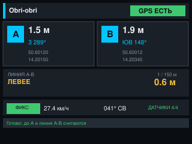
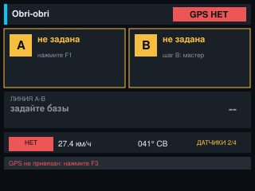
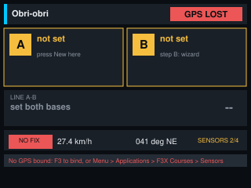
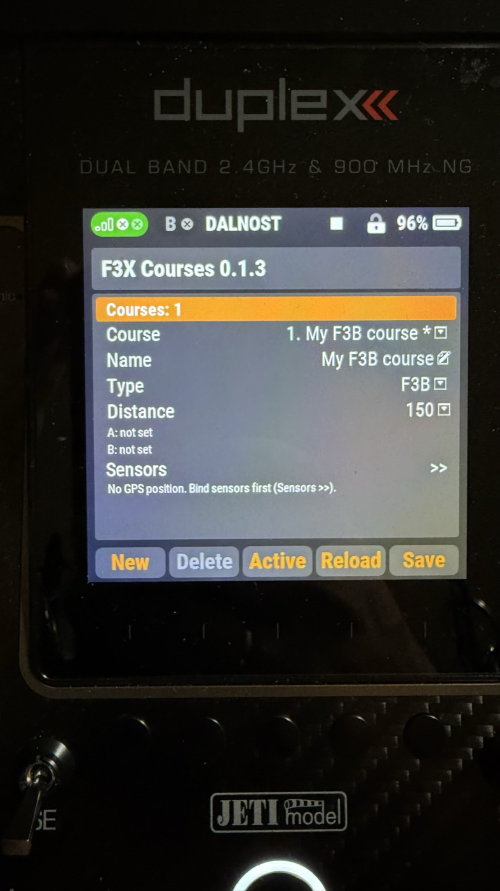

# История версий

Короткая хронология: что менялось и почему. Подробный разбор — в
[PROGRESS.md](PROGRESS.md), текущее состояние — в [SESSION.md](SESSION.md).
Скриншоты — в [screens/](screens/).

> Правило проекта: **каждое изменение уходит в GitHub** — код, документация и
> скриншоты вместе, чтобы любую версию можно было вернуть и посмотреть, как она
> выглядела.

## 0.1.5 — русский интерфейс

Все надписи, которые видит пользователь, переведены на русский: телеметрийное
окно, формы курсов и датчиков, канвас-страницы, сообщения и подписи кнопок.

Что изменилось на экране:

| Было | Стало |
|---|---|
| `GPS OK` / `GPS LOST` | `GPS ЕСТЬ` / `GPS НЕТ` |
| `not set` | `не задана` |
| `LINE A-B` | `ЛИНИЯ A-B` |
| `ON LINE` / `LEFT` / `RIGHT` | `НА ЛИНИИ` / `ЛЕВЕЕ` / `ПРАВЕЕ` |
| `FIX` / `NO FIX` | `ФИКС` / `НЕТ` |
| `SENSORS n/4` | `ДАТЧИКИ n/4` |
| `N/NE/E...` | `С/СВ/В...` |
| `spd 27.4 km/h` | `27.4 км/ч` |
| `Courses:`, `Name`, `Type`, `Distance` | `Курсов:`, `Название`, `Тип`, `Дистанция` |
| кнопки `New`/`Delete`/`Active`/`Save` | `Новый`/`Удалить`/`Активный`/`Сохранить` |
| кнопки окна `New`/`Next`/`Bind`/`Save` | `Новый`/`Далее`/`Датч`/`Сохранить` |

Подсказка внизу окна теперь объясняет по-русски, что мешает прямо сейчас:
«GPS не привязан: нажмите F3», «База A пуста: встаньте на A, нажмите F1»,
«Готово: до A и линия A-B считаются».

**Ограничение, о котором нужно знать.** В таблице символов API 1.7 (коды
171–382) кириллицы нет — только латиница, польские, чешские и венгерские буквы;
русской локали в `Lang/` тоже нет. При этом на карте уже лежит рабочее
приложение `PIKEX202.lua`, которое рисует `латунь`, `красный`, `Черный` через
`lcd.drawText`, и в прошивке есть китайский и японский шрифты. Поэтому перевод
сделан, но **первым делом на передатчике проверьте, что буквы видны** — если
шрифт покажет квадраты, вернуть английский можно за одну правку строк.

Технические детали:

- подписи кнопок окна ограничены 7 символами (`setTelemetryButton`) — все
  русские подписи короче;
- ширина текста в `tools/preview-telemetry.lua` теперь считается в символах
  (UTF-8), а не в байтах, с поправкой на более широкую кириллицу;
- тесты `tools/test-app.lua` ищут русские подстроки `ЛИНИЯ A-B`, `ДАТЧИКИ`;
- латинскими осознанно оставлены `F3B`/`F3F`, `GPS`, `A`/`B` — это имена
  параметров и обозначения, которые в прошивке не переводятся.

## 0.1.4 — полноэкранное окно телеметрии

Окно для `Timers/Sensors → Displayed Telemetry` переписано с нуля: вместо списка
строк — полноэкранный прибор с базами A и B, линией A–B и живой диагностикой.

Что на экране:

- **шапка**: имя активного курса и индикатор `GPS OK` / `GPS LOST`;
- **плитка A** и **плитка B**: расстояние до базы, пеленг словом и числом
  (`NE 041 deg`), координаты; незаданная база подсвечивается жёлтым и прямо
  пишет, чего не хватает;
- **шкала линии A–B**: подписано `ON LINE` / `LEFT` / `RIGHT`, отклонение в метрах,
  пройденное расстояние по линии и метки `-30 / 0 / +30 м`;
- **нижняя строка**: `FIX`/`NO FIX`, скорость, курс, `SENSORS n/4` — сколько из
  четырёх значений привязано;
- **подсказка**: одна строка о том, что мешает прямо сейчас и что нажать.

Клавиши в полноэкранном окне: `F1` новый курс от текущей позиции, `F2` следующий
курс, `F3` перепривязать датчики, `F4` перечитать с карты, `F5`/`Enter` сохранить.

Почему это вообще стало возможно: в API 1.7 `system.registerTelemetry` принимает
размер окна, и **только размер 3 и выше** занимает весь экран и **только он
передаёт нажатия клавиш**. Раньше стоял размер 2 (две позиции).

Вёрстка адаптивная: на 800×480, 320×240 и на узком окне блоки ужимаются, шкала
и подсказка убираются по необходимости — ничего не наезжает друг на друга.

Ещё:

- `tools/preview-telemetry.lua` — рисует окно в SVG на Mac, без передатчика;
- `tools/test-app.lua`: сценарий 5 — размер окна, клавиши, кнопки, отрисовка
  на четырёх размерах экрана, курс с обеими базами.

## 0.1.3 — приложение запущено на передатчике

Первая версия, которая **реально работает на DS-24 II**. Форма открывается,
виджеты строятся, журнал пишет `ready`.

Что было сделано:

- **найдена настоящая причина «нет в меню»**: `F3 (Plus)` открывает список
  *доступных* файлов, а не активных приложений; файл добавляется нажатием
  крутилки на его строке. Файл на карте был исправен всё время;
- резервный режим «только канвас» стал полноценным интерфейсом (две страницы,
  навигация, создание/удаление/активация курсов, авто-привязка датчиков);
- журнал `Apps/f3xc/lastrun.txt` пишется с немедленным сбросом на карту —
  по нему видно, что именно произошло при запуске;
- тест `tools/test-app.lua` получил сценарий «прошивка принимает только
  `nil init + key + print`» — ровно то, как устроены все рабочие приложения
  на этой карте.

Проверено на железе: DS-24 II, прошивка 6.06, модель `0005PIKE.jsn`.

## 0.1.2 — форма регистрируется, журнал запуска

- `system.registerForm` получает `printFunction` всегда (без неё форма
  не регистрируется);
- исправлен порядок объявлений: `initForm` объявлен до обёртки
  (было `nil`, `pcall` проглатывал ошибку и отменял регистрацию);
- регистрация по цепочке `MENU_APPS → MENU_ADVANCED → MENU_MAIN`
  с повторной попыткой «только канвас»;
- журнал `Apps/f3xc/lastrun.txt`;
- `docs/TROUBLESHOOT-NO-MENU.md`.

## 0.1.1 — профиль датчика GPSLog3

- датчик определён по реальной модели: **GPSLog3**, ID `823632641`,
  Lat=3, Lon=4, Speed=5 (**км/ч**), Dir=9;
- профиль зашит в `KNOWN`, `bindKnownProfile()` вызывается перед `guessSensors()`;
- тесты `tools/test-bind.lua`;
- инструменты: `tools/scan-sensors.sh`, `tools/install-to-tx.sh`,
  `tools/sensors_dump.lua`.

## 0.1.0 — скелет (шаг A)

- одно приложение, один файл `Apps/f3xc.lua`;
- хранение курсов в `Apps/f3xc/courses.jsn`;
- страница курсов: создание из позиции GPS, переименование, тип F3B/F3F,
  дистанция, удаление, выбор активного;
- страница датчиков `Sensors >>`: привязка Lat / Lon / Speed / Dir ко **всем**
  телеметрическим значениям, а не только к типу GPS;
- телеметрийное окно.

## Что дальше

Шаг B — мастер по двум базам (A/B), затем шаг C — геометрия ворот и писк.
План — в [ROADMAP.md](ROADMAP.md).
